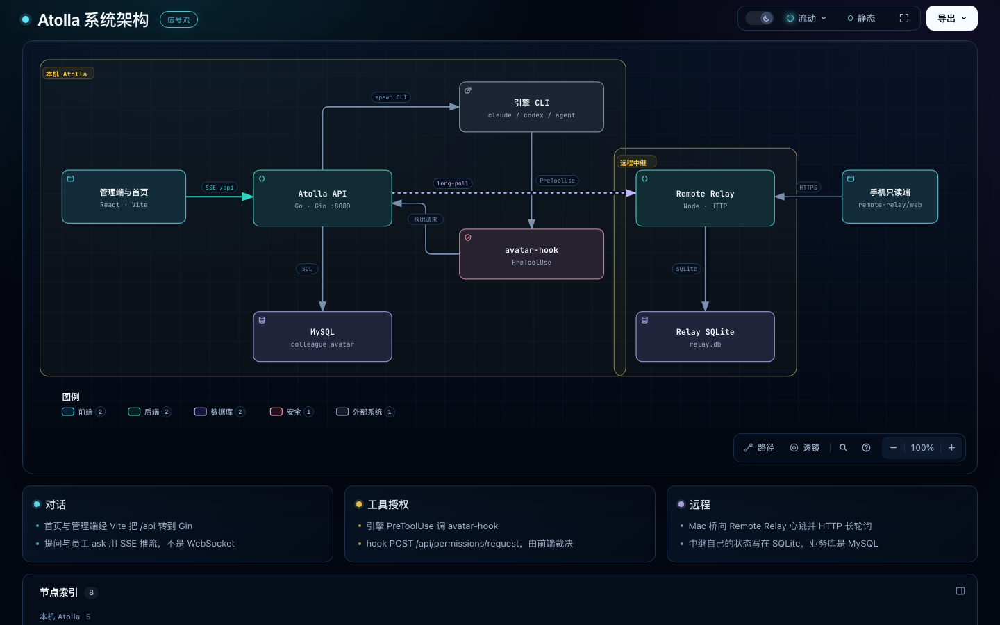

# Atolla

[English](README_EN.md)

在你自己的电脑上跑一队数字员工。员工背后是本机的 Claude、Codex 或 Cursor Agent，在授权过的工作区里干活，危险操作先问你再执行。

当前版本 **v0.5.9**。



## 能做什么

- 用 Claude、Codex、Cursor Agent 创建数字员工，绑定工作区
- 首页和管理台流式对话；一个员工同时只做一件主任务
- 写文件、联网、删除等操作先审批，也可按会话自动放行
- 员工之间用 `@` 互相调用；项目协作用可视化流程图编排
- 手机通过远程中继只读查看和继续对话，Bark 通知可单独开关

## 开始使用

需要 Docker、Go 1.22+、Node.js 20+，以及至少一个引擎命令：`claude`、`codex` 或 `agent`。

```bash
cp .env.example .env
./scripts/start.sh
```

浏览器打开 http://localhost:5173 。第一次进入会检查引擎，并引导你注册管理员。

MySQL 已经在跑时：

```bash
./scripts/start.sh --skip-db
```

停掉或重启：`./scripts/shutdown.sh`、`./scripts/restart.sh`。

| 服务 | 地址 |
| --- | --- |
| 页面 | http://localhost:5173 |
| API | http://localhost:8080 |
| MySQL | `127.0.0.1:3307` |

## 技术栈

Go（Gin）· React（Vite）· MySQL 8 · 本机 CLI 引擎

对话用 SSE 推流。手机中继是 HTTP 长轮询，不是 WebSocket。交互架构图：[docs/architecture/atolla-architecture.html](docs/architecture/atolla-architecture.html)。

## 配置

密钥放在仓库根目录的 `.env`，不要提交。常用项：

| 变量 | 作用 | 默认 |
| --- | --- | --- |
| `AVATAR_ADDR` | API 监听地址 | `:8080` |
| `AVATAR_DB_DSN` | MySQL 连接串 | 本机 `3307` / `colleague_avatar` |
| `AVATAR_ALLOWED_IPS` | 允许访问的客户端 IP，空则看鉴权路径 | `127.0.0.1` |
| `AVATAR_ADMIN_USER` / `AVATAR_ADMIN_PASS` | 管理员账号 | 请改掉 |
| `BARK_KEY` | iPhone Bark 推送，可留空 | — |

完整列表见 [.env.example](.env.example)。

## 许可证

见 [LICENSE](LICENSE)。
