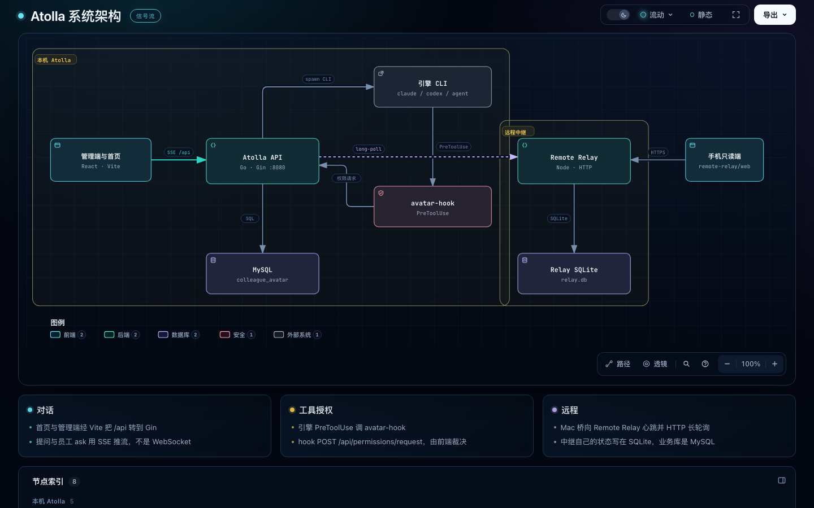

# Atolla

[中文](README.md)

Run a fleet of digital colleagues on your own machine. Each colleague is a local Claude, Codex, or Cursor Agent. They work inside workspaces you allow, and they ask before doing anything risky.

Current release: **v0.5.11**.



## What it does

- Create colleagues on Claude, Codex, or Cursor Agent and bind them to a workspace
- Stream chat from the home page and the admin console; one colleague, one primary task
- Approve writes, network access, and deletes, or auto-approve for a session
- Let colleagues call each other with `@`, and arrange them in a visual workflow
- Read and continue chats from a phone through the remote relay; Bark alerts can be turned off per type

## Quick start

You need Go 1.22+, Node.js 20+, and at least one of `claude`, `codex`, or `agent` on your `PATH`. SQLite is the default (no Docker). Docker is only needed if you choose MySQL.

```bash
cp .env.example .env
./scripts/start.sh
```

Open http://localhost:5173 . The first visit checks your engines and asks you to register an admin account.

Foreground keeps the terminal busy. To close the window and keep running:

```bash
./scripts/start-bg.sh
# or ./scripts/start.sh --daemon
```

Logs: `logs/backend.log`, `logs/frontend.log`. Stop with `./scripts/shutdown.sh`.

Optional MySQL (starts docker compose):

```bash
./scripts/start.sh --mysql
# background: ./scripts/start-bg.sh --mysql
```

Stop or restart with `./scripts/shutdown.sh` and `./scripts/restart.sh` (add `--daemon` to stay in background).

| Service | Address |
| --- | --- |
| Web | http://localhost:5173 |
| API | http://localhost:8080 |
| SQLite (default) | `./data/atolla.db` |
| MySQL (optional) | `127.0.0.1:3307` |

## Stack

Go (Gin) · React (Vite) · SQLite (default) / MySQL 8 (optional) · local CLI engines

Chat is server-sent events. The phone relay uses HTTP long-poll, not WebSocket. Interactive diagram: [docs/architecture/atolla-architecture.html](docs/architecture/atolla-architecture.html).

## Configuration

Keep secrets in `.env` at the repo root. Do not commit that file.

| Variable | Purpose | Default |
| --- | --- | --- |
| `AVATAR_ADDR` | API listen address | `:8080` |
| `AVATAR_DB_DRIVER` | Platform DB `sqlite` / `mysql` | `sqlite` |
| `AVATAR_DB_DSN` | sqlite file path or mysql DSN | `./data/atolla.db` |
| `AVATAR_ALLOWED_IPS` | Client IP allowlist | `127.0.0.1` |
| `AVATAR_ADMIN_USER` / `AVATAR_ADMIN_PASS` | Admin login | change these |
| `BARK_KEY` | Optional iPhone Bark key | — |

See [.env.example](.env.example) for the full list.

## License

[LICENSE](LICENSE).
