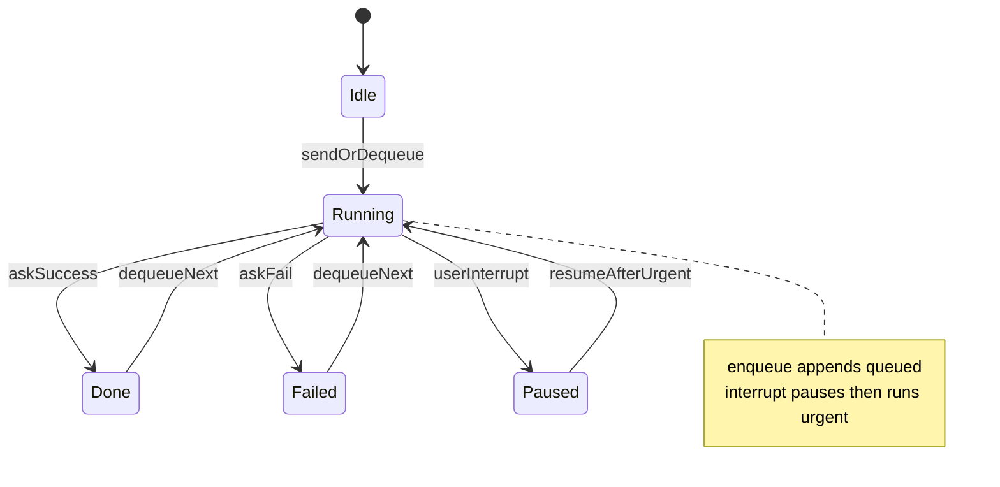

# 数字人任务队列（PC）

## 1. 背景

当前在数字人对话中，忙碌时再次发送会走「插话」：`/stop` 后立刻带上下文开跑新消息，无法把后续任务排队。用户需要系统级任务队列：一条跑完再取下一条，并由 UI 展示进度；打断时优先执行紧急消息，被打断的队列任务进入中间态，紧急任务结束后立刻恢复。

状态机由平台系统控制，不交给模型。

## 2. 开发目标

- PC 端单数字人对话支持 **持久化任务队列**（MySQL/SQLite 落库，禁止仅内存/前端缓存作为唯一真相）。
- 忙碌发送时底部弹窗二选一：**打断（优先）** / **进入队列（追加末尾）**。
- 对话区右侧细轨 + 抽屉：紫呼吸灯=排队/暂停，运行中单独态，绿=完成；hover 看原文。
- 出队与恢复由服务端状态机驱动；与「@ 多人生成群聊」互斥。

## 3. 实现范围

### 本次实现

- PC 管理台现代/经典对话页（`ManagedAgents`）发送拦截弹层、右侧队列轨/抽屉。
- 服务端：`agent_task_queue` 表、CRUD/出队 API、Ask 结束钩子自动 dequeue、打断暂停栈语义。
- 与现有 Stop / AskManaged / 插话路径整合；空闲直发行为不变。

### 本次暂不实现

- 移动端 / 中继 App 任务队列。
- 跨数字人共享队列、拖拽排序、队列内编辑正文。
- 模型侧「自行决定是否入队」。

## 4. 技术设计

### 4.1 核心概念

| 概念 | 说明 |
|------|------|
| 队列归属 | 按 `agent_id` 隔离 |
| 真相源 | 仅数据库；前端只展示与操作，刷新后从 API 回读 |
| 当前运行 | 仍走现有 `AskManaged` 一轮；同时刻同一数字人最多一条 running Ask |

### 4.2 任务状态（系统状态机）

```text
queued   → running → done
                   ↘ failed
queued   → cancelled          （用户取消未跑项）
running  → paused             （被打断；不可标成未完成/done）
paused   → running            （紧急任务结束后立刻恢复重跑）
```

- **queued**：紫灯（待跑）
- **paused**：紫灯（或略异形，如双环），语义=中间态，须恢复
- **running**：高亮紫/蓝呼吸（与 queued 区分）
- **done**：绿灯
- **failed / cancelled**：灰或红；可提供移除

**暂停栈规则（打断）**

1. 用户选择「打断」并提交紧急消息 `U`：
   - 若当前有 `running` 任务节点 `T`（来自队列或「当前轮也登记为队列节点」）：将 `T` 标为 `paused`，**插入恢复优先级最高位**（LIFO：后打断的先恢复）。
   - `/stop` 当前 Ask。
   - 将 `U` 作为新任务 `running`（也落库，便于轨上展示），立即 Ask。
2. `U` 结束（done/failed）后：取优先级最高的 `paused` → 改 `running` → **重新执行该任务原文**（完整再跑一轮，不接半截模型输出）。
3. 无更多 `paused` 后：按 `queued` 的 `position` 升序出队。
4. 打断时 **已 queued 未跑项保留**，仍在末尾之后；紧急 `U` 不插队到 queued 中间，而是「当前优先」，paused 在 U 之后、queued 之前恢复。

**入队**

- 选择「进入队列」：新任务 `status=queued`，`position = max(position)+1`，**不** stop 当前。

**空闲发送**

- 无 running：直接 Ask；同时可登记一条 `running` 轨节点（便于全绿进度），或仅在「曾用过队列/存在未完成项」时写轨——实现上统一：**凡经本数字人发送的一轮都可记 queue 行**，抽屉有数据才显眼。

### 4.3 与 @ 多人群聊互斥

- **任务态**：该 agent 存在 `queued|paused|running` 队列项（或本地判定「队列模式开启且队列非空」）时：
  - 禁止触发「3～5 人生成群聊」岔路；多 @ 按普通文本入队/发送，不弹群聊 offer。
- **多人对话态**：已打开群聊 offer、或当前输入解析为可生成群聊的多 @ 且用户走群聊路径时：
  - 禁止入队；忙碌时弹窗只保留「打断」或提示「多人协作中不可使用任务队列」（实现选：**有多 @ 群聊资格时不展示「进队列」**）。
- 两者不可同时进行。

### 4.4 数据表（持久化，禁止缓存当真相）

```sql
CREATE TABLE agent_task_queue (
  id            BIGINT PRIMARY KEY AUTO_INCREMENT,
  agent_id      BIGINT NOT NULL,
  conversation_id BIGINT NULL,
  status        VARCHAR(32) NOT NULL,  -- queued|running|paused|done|failed|cancelled
  question      TEXT NOT NULL,
  attachments_json TEXT NULL,          -- 聊天图片等 JSON
  position      INT NOT NULL DEFAULT 0, -- queued 排序；paused 用 pause_rank
  pause_rank    INT NULL,              -- LIFO，越大越先恢复
  error_text    VARCHAR(512) NULL,
  created_at    DATETIME NOT NULL,
  started_at    DATETIME NULL,
  finished_at   DATETIME NULL,
  INDEX (agent_id, status),
  INDEX (agent_id, position),
  INDEX (agent_id, pause_rank)
);
```

SQLite 同等结构。进程重启后：若有 `running` 无活 Ask，启动时降为 `paused` 或 `failed` 并触发恢复策略——**建议降为 `paused` 并在 agent 空闲时自动 resume**，避免假 running。

### 4.5 API（草案）

- `GET /api/admin/agents/:id/task-queue` — 列表（含 done 最近 N 条供绿灯轨）
- `POST /api/admin/agents/:id/task-queue` — 入队 `{ question, attachments }`
- `POST /api/admin/agents/:id/task-queue/interrupt` — 打断并优先跑 `{ question, attachments }`（服务端：pause running → stop → 创建 running 紧急项 → Ask）
- `POST /api/admin/agents/:id/task-queue/:taskId/cancel` — 取消 queued/paused
- `DELETE` 或 `POST .../clear-done` — 清除已完成展示

Ask 正常结束钩子（`AskManaged` finally / notifyAgentTerminal 旁路）：

1. 将当前 `running` 标 done/failed  
2. 若有 `paused`（按 pause_rank DESC）→ resume  
3. 否则取最小 `position` 的 `queued` → running → Ask  
4. 前端 SSE/轮询刷新队列轨

**禁止**：前端 localStorage/内存队列作为唯一调度；前端乐观 UI 必须以 API 回读校正。

### 4.6 PC UI

1. **底部弹层**（忙碌且发送时）：文案精简  
   - 「打断当前并优先执行」  
   - 「加入任务队列」  
   - 取消  
2. **右侧小三角**：点击展开抽屉；有 queued/paused/running/近期 done 时显示角标数量。  
3. **抽屉内垂直轨**：圆点 + 连线；紫=queued/paused，运行中高亮，绿=done；hover Tooltip=question 摘要。  
4. 支持取消未跑项、清除已完成；上限建议 20 条活跃（queued+paused+running），满则拒绝入队。

### 4.7 状态机示意



### 4.8 关键模块

- 前端：[`web/src/ManagedAgents.jsx`](web/src/ManagedAgents.jsx)（`ask` 插话分支改造）、新建 `TaskQueueRail`/`TaskQueueSheet` 组件  
- 后端：[`server/internal/service/managed_agents.go`](server/internal/service/managed_agents.go) Ask 结束钩子；新建 `task_queue` store + handler  
- 群聊岔路：[`GroupChatOfferSheet`](web/src/GroupChatOfferSheet.jsx) / `buildGroupMemberSet` 与队列态互斥

## 5. 变更影响

| 原设计/现状 | 新设计 |
|-------------|--------|
| 忙碌再发 = 一律插话 stop+立刻 Ask | 弹窗：打断（pause+优先）或入队（追加） |
| 无跨轮任务编排 | 服务端队列 + 自动出队/恢复 |
| 插话不保留「被打断任务」 | running → paused，紧急结束后重跑 |
| @ 多人与插话可叠加触发 | 与任务队列互斥 |
| 无持久队列 | DB 表为唯一真相，禁止缓存替代 |

## 6. 开发 TODO

- [ ] Store：`EnsureAgentTaskQueueSchema` + CRUD / pause / resume / dequeue
- [ ] Service：InterruptPrefer / Enqueue / OnAskTerminal 调度；重启修复假 running
- [ ] Handler：admin task-queue API
- [ ] 前端：忙碌发送弹层；改造 `ask()`；去掉「静默插话」为默认
- [ ] 前端：右侧轨 + 抽屉 + hover；轮询/事件刷新队列
- [ ] 互斥：队列活跃时禁用群聊 offer；多 @ 群聊路径禁用入队
- [ ] 单测：出队顺序、打断 pause 栈 LIFO、入队 position、重启降级
- [ ] i18n：弹层与抽屉中英文案

## 7. 待确认事项（已拍板）

- [x] 打断时未跑队列：保留，紧急优先  
- [x] 入队：追加末尾  
- [x] 打断队列中正在执行的节点：paused 中间态，紧急结束后立刻重跑  
- [x] 与 @ 多人群聊互斥  
- [x] 必须落库，禁止仅缓存  
- [x] 风险项默认策略：见 §8（全部已定，可开工）

## 8. 风险项最佳决策（实现必须遵守）

### 8.1 paused 重跑与上下文

- **决策**：重跑仍用**任务原文**发起新一轮 Ask（不拼半截 assistant）。
- **系统前缀**：加一条极短、固定、不对用户展示为「用户原话」的内部上下文（或一条 `system`/平台旁白入库可见但样式弱化）：  
  `（系统）上一轮执行被紧急任务打断，请根据最新对话完整重新完成本任务，避免重复已完成的副作用。`  
- **不做**：真正的断点续跑（引擎做不到可靠续跑）。
- **文案**：UI 写「恢复并重新执行」，避免用户以为接着半截聊。

### 8.2 命令审批 waiting

- **决策**：`waiting`（待授权）视为**阻塞中的 running 轮**，不算空闲，**不出队下一条**。
- **入队**：允许（追加 queued）。
- **打断**：允许；对当前轮：`StopManaged` + 拒绝/清理该轮未决 permission（与现网 stop 行为对齐），当前队列节点 → `paused`，再跑紧急任务。
- **禁止**：在 waiting 时静默 dequeue 下一条（会双线执行）。

### 8.3 Stop（终止）vs 打断

| 操作 | 当前 running 节点 | paused / queued | 之后 |
|------|-------------------|-----------------|------|
| 打断 | → paused | 保留 | 跑紧急 → 自动 resume/dequeue |
| 终止 Stop | → `cancelled`（用户主动停） | **保留** | **不自动**续跑；角标提示「队列已暂停」，提供「继续队列」按钮 |

- **决策**：Stop = 用户要停手；只有「继续队列」或再次发送（空闲直发/打断）才恢复调度。

### 8.4 并发与幂等

- **决策**：服务端按 `agent_id` **互斥锁**（DB 行锁或进程内 mutex + 条件更新 `status`）。
- Ask 结束钩子用 `UPDATE ... WHERE id=? AND status='running'` 幂等收尾；影响行数为 0 则不再 dequeue。
- 所有入口（PC / 日后手机 / 中继）只能打 **Enqueue / InterruptPrefer / ContinueQueue**，禁止旁路直接 Ask 打乱状态机。

### 8.5 紧急任务失败

- **决策**：紧急任务 `failed` 后仍按 LIFO **自动 resume paused**（失败不等于用户要弃队）。
- UI：紧急条标红；paused 恢复照常。

### 8.6 连续打断深度

- **决策**：`paused` 栈上限 **5**；再打断时拒绝并提示「请先处理紧急任务或终止」。
- 活跃任务（queued+paused+running）上限 **20**；满则拒入队。

### 8.7 附件

- **决策**：仅当图片等已 `ensureUploaded` 成功后才允许入队/打断提交；`attachments_json` 存稳定 URL/id。
- 上传中禁用弹层确认键。

### 8.8 会话绑定

- **决策**：队列项绑定创建时的 `conversation_id`。
- 出队/恢复时：若数字人「当前打开会话」≠ 任务会话，**仍在任务绑定的 conversation 上执行**（保证连续性）；前端若切到别的线程，轨上标注「将在会话 #x 执行」。
- 不把队列任务误写入用户临时点开的其它空会话。

### 8.9 项目协作占用 / 复制整理记忆

- **决策**：存在 workflow / clone_init 等 **chatLocked** 时：禁止 InterruptPrefer 与 ContinueQueue；**允许入队**（忙完再跑）。
- 占用结束后自动 `ContinueQueue`（若有 queued/paused）。

### 8.10 进程重启

- **决策**：启动扫描：`running` → `paused`（假运行降级）。
- **不自动 resume**；等用户打开该数字人或点「继续队列」。
- 避免无人值守半夜续跑高风险命令。

### 8.11 灯色

- queued：紫呼吸  
- paused：紫 + 双环/暂停符（与 queued 区分）  
- running：高亮紫或蓝呼吸  
- done：绿  
- failed：红；cancelled：灰  

### 8.12 任务规划

- **决策**：pause 粒度 = **整条用户消息对应的一轮 Ask**（含其内部 task plan 步骤）。
- 不按规划子步 pause。

### 8.13 Bark / 完成通知

- **决策**：同一 agent 在「队列连跑」（结束钩子自动 resume/dequeue 触发的轮次）中：**不逐条推**完成 Bark；仅在队列回到空闲（无 running/paused/queued）时推 **一条**汇总，或跳过自动连跑的中间完成、只保留用户手动首条/紧急条的可推送策略。  
- 实现偏好：`dequeue/resume` 触发的 Ask 带 `silent_notify=true`；用户直接发送或打断紧急任务仍可按现网规则通知。

### 8.14 @ 互斥细则

- **可进群聊 offer**：空闲、无 queued/paused/running，且 @ 人数达群聊门槛。  
- **队列活跃**（有 queued/paused/running）：永不弹群聊 offer；文案里的 @ 当普通文本。  
- **已弹出群聊 offer**：隐藏「进队列」；只可取消 offer 或生成群聊。  
- 单 @ 一个人：不走群聊，可入队/打断。

### 8.15 移动端

- **升级**：见 [`2026-10-28-移动端任务队列.md`](./2026-10-28-移动端任务队列.md)。  
- 新 App：忙碌弹层（5s 默认**打断**）+ 角标 + 半屏列表。  
- 旧客户端无 `mode`：服务端忙碌仍 **Enqueue** 兜底。

### 8.16 失败是否堵队

- **决策**：单条 `failed` **不堵队**，继续 resume/dequeue。
- 抽屉提供「失败后暂停队列」开关可留到二期；一期不做。

### 8.17 副作用重跑（产品诚实）

- 文案与 hover 提示：恢复将重新执行，可能重复工具调用。
- 不在一期做命令级幂等去重（成本过高）。

确认本方案后即可按 TODO 开工（仅 PC 队列 UI；移动端仅服务端默认入队兜底）。
