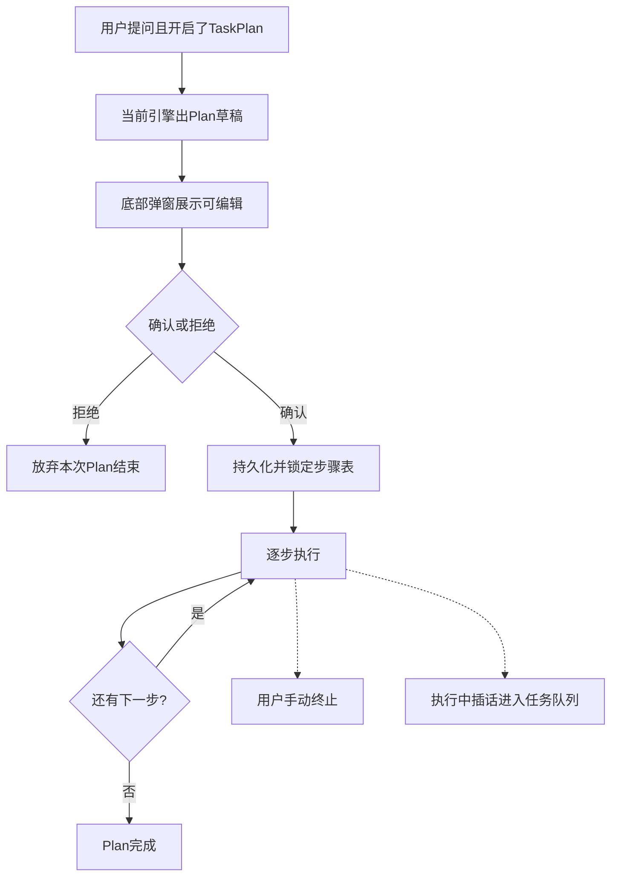

# Task Plan 重做设计（一问两拍 · 确认后按表执行）

> 日期：2026-11-08
> 范围：colleague-avatar（PC Server + remote-relay Web/手机 + 灵动岛）
> 状态：设计稿，**本阶段不改代码**
> 目标读者：后续开发 Agent / 产品同学（通俗可读）

---

## 1. 背景

### 现在有什么问题

当前 Task Plan（`task_plan_enabled`）大致是：

1. 用户发问后，**另开一轮引擎调用**只为拆出 4～8 条步骤（偏 JSON / 启发式）。
2. 主任务开始后，单引擎长跑基本**钉死在第 0 步**，结束时再一次性 `done`。
3. 用户几乎看不到「做到哪一步」；进度像装饰，不像真正按计划干活。
4. 计划不可编辑、无明确「确认 / 拒绝」，也没有可靠的断点恢复体验。

一句话：**多打了一次模型，又没换来可控执行。**

### 这次为什么重做

产品定稿要变成：

- **不再另开模型做拆分**，用**当前数字人自己的引擎**在本轮对话里先出 Plan。
- PC / 手机统一：**底部弹窗**展示步骤，可折叠看详情，**允许用户改 Plan**。
- 用户点 **确认** → 按冻结后的 Plan **一步一步执行到完**。
- 用户点 **拒绝** → **放弃本次 Plan**，不做别的。
- 执行中：Plan **先持久化**，可断点恢复；**不允许插话打断执行**，插话进**任务队列**；用户可**手动终止**整份 Plan。

这是前后端联动的大改，属于功能重做，而不是小修。

---

## 2. 开发目标

做成用户能懂的「一问两拍」：

```text
第 1 拍：Agent 用当前引擎出 Plan → 底部弹窗给你看/改 → 确认或拒绝
第 2 拍：你点确认后，按表逐步执行 → 做完一步亮一步 → 全部完成或你手动终止
```

落地后必须同时满足：

| 目标 | 说明 |
|------|------|
| 同引擎规划 | 取消「专用拆分再调一轮」路径；规划就是当前 agent 引擎的一次受控回合 |
| 人审闸门 | 确认前不改业务代码；确认后步骤表锁定（允许此前在弹窗里编辑） |
| 真进度 | 执行按步骤推进并上报；PC 面板 + 手机灵动岛能看到当前步 |
| 持久化 | Plan 落库，进程重启 / 断线后可恢复「执行到哪」 |
| 执行不插话 | Plan 运行中用户新消息进任务队列，不打断当前 Plan |
| 可终止 | 用户可手动终止整份 Plan（与「插话入队」区分） |

---

## 3. 实现范围

### 3.1 本次实现

- 后端：Plan 状态机、持久化、确认/拒绝/终止 API、逐步执行编排、与任务队列协同。
- 前端（PC + 手机 Web）：底部 Plan 弹窗（步骤标题/详情、折叠、编辑、确认/拒绝、执行中进度、终止）。
- 镜像 / 灵动岛：沿用并扩展 `atolla.task_plan.v1`，在 `awaiting_confirm` / `running` 时优先重点展示。
- 配置：保留 agent 级 `task_plan_enabled`；开启才走两拍；关闭则保持普通直答。

### 3.2 本次暂不实现

- Cursor 式长篇设计文档 / 独立 Plan Mode IDE 体验。
- 多 Agent 协作场景下「每人一份子 Plan」的复杂编排（可先复用现有 @委托，整份 Plan 仍挂在主 agent）。
- Plan 执行中单步「跳过 / 重做某一步」的细粒度控件（仅整单终止；后续可加）。
- 自动根据仓库 Diff 反向改写 Plan 步骤。

---

## 4. 技术设计

### 4.1 用户流程（通俗版）



**拒绝**：关掉弹窗，标记 Plan 为 `rejected`，本轮不执行、不改代码。
**确认**：以弹窗里**最终编辑结果**为准锁定，开始执行。
**终止**：执行中用户点「终止 Plan」→ 停引擎当前跑批、Plan 标 `aborted`；队列里其他任务规则不变。
**插话**：执行中发消息 → **只入队**，不打断当前 Plan（与现有 task queue 对齐并强化）。

### 4.2 状态机

建议统一 phase（写入持久化 + SSE + mirror）：

| phase | 含义 | 用户可见 |
|-------|------|----------|
| `planning` | 引擎正在生成 Plan | 可显示「正在拟定计划…」 |
| `awaiting_confirm` | Plan 已出，等确认/拒绝 | **底部弹窗** |
| `running` | 已确认，逐步执行中 | 进度条 + 当前步；可终止 |
| `done` | 全部步骤成功结束 | 完成态 |
| `failed` | 某步失败导致整单失败 | 失败态 |
| `rejected` | 用户拒绝 | 无后续执行 |
| `aborted` | 用户手动终止 | 已执行部分保留记录 |

步骤级 status 仍用：`pending` / `active` / `done` / `failed` / `skipped`。

**硬规则：**

1. `awaiting_confirm` 之前：禁止落业务改动（规划回合只读探查 + 产出 Plan）。
2. 用户确认瞬间：以客户端提交的 steps 为准 **freeze**，之后执行不得改 title/顺序/步数。
3. 推进只允许 `CompleteThrough` / 下一步 `Activate`，禁止跳步、禁止回跳。
4. `running` 期间用户普通 Ask → 入 `agent_task_queue`，不 `stop` 当前 Plan。

### 4.3 数据模型（持久化）

**原则：Plan 必须先落库再执行**，便于断点恢复。

推荐演进现有 `agent_tasks`（已有 progress/message/payload）或新增专用表 `agent_task_plans`。为降低迁移成本，优先 **扩展 `agent_tasks.payload` + 明确 status/phase**，字段约定如下。

协议升级为：`atolla.task_plan.v2`（v1 读兼容，写用 v2）。

```json
{
  "schema": "atolla.task_plan.v2",
  "plan_id": "plan-123-...",
  "agent_id": "7",
  "conversation_id": 42,
  "source_question": "用户原话",
  "phase": "awaiting_confirm",
  "frozen": false,
  "task_name": "短标题",
  "current_step": 0,
  "completed_count": 0,
  "total_count": 4,
  "progress": 0,
  "message": "等待确认",
  "step_items": [
    {
      "id": "s0",
      "title": "查现状",
      "detail": "阅读相关模块，确认现有 task plan 入口与队列行为。",
      "status": "pending"
    }
  ],
  "created_at": 1730000000,
  "confirmed_at": null,
  "updated_at": 1730000000
}
```

**步骤文案约束（产品 · 已定稿）：**

- `title` 长度按 **Unicode rune（码点）计**，**硬上限 ≤ 6**（中英文同一规则）。
  - 例：`查现状`、`写接口`、`FixBug`（6 个字符以内）。
  - 超长：前端即时提示；服务端截断或拒收（实现选拒收 + 提示，避免静默裁切语义）。
- `detail`：存全文；弹窗默认折叠，展开查看/编辑（仅 `awaiting_confirm`）；建议 UI 预览约 200 字，全文可滚。

**断点恢复（已定稿：手动，不自动续跑）：**

- 进程中断 / 挂起后：队列里该 **Plan 原子项** 变为 `paused`（不是再插一条新队列）。
- 用户在任务队列中选择 **继续** 或 **放弃**（放弃 = abort Plan，不是普通删队列项）。
- `awaiting_confirm`：**不超时作废**；重启后仍拉起底部确认弹窗；可发 Bark（对齐现有命令待审批通知）。

### 4.4 后端核心流程

涉及现有模块（将改造，而非小补丁）：

| 模块 | 路径（现有） | 改造要点 |
|------|----------------|----------|
| 拆分 | `server/internal/service/task_plan_concrete.go` | **删除/停用**「另开引擎只吐 JSON」主路径 |
| 进度 | `server/internal/service/task_progress.go` | 扩展 phase、detail、freeze、确认前不进入 running 执行 |
| Ask 主链 | `server/internal/service/managed_agents.go` | 开启 task_plan 时：先规划回合 → 等确认 → 再逐步执行 |
| 镜像 | `remotebridge/agent_snapshot.go` / `handlers.go` | 下发 v2 plan（含 awaiting_confirm） |
| 队列 | `store/agent_task_queue.go` + managed ask 入口 | running Plan 时强制新消息入队 |
| API | `handler/managed_agents.go` 等 | 新增确认/拒绝/终止/拉取/更新草稿 |

#### 4.4.1 规划回合（第 1 拍）

1. 用户提问，`task_plan_enabled=true`，且非「跳过 Plan」入口。
2. 创建 `agent_tasks` 行：`phase=planning`，持久化。
3. 用**当前 agent 引擎**跑「只产出 Plan」的受控提示（可读代码，**noHook / 禁写业务**策略加强）。
4. 解析结果为 `step_items[{id,title,detail}]`，校验步数（建议 3～6，上限 8）、title 长度。
5. 写入 DB：`phase=awaiting_confirm`，`frozen=false`。
6. SSE / 中继推送：`type=task_plan`，前端弹底部窗。

> 不再调用「另一个模型」；就是当前数字人引擎。提示词要求输出结构化 MD 或 JSON（实现可选：模型输出 MD，服务端抽取结构），但**对用户主展示是弹窗表单，不是生 JSON 刷屏**。

#### 4.4.2 确认 / 拒绝

- `POST .../task-plan/{plan_id}/confirm`
  Body：可选带用户编辑后的 `step_items`（以客户端提交为准再校验）。
  服务端：校验 → 写回 → `frozen=true` → `phase=running` → `current_step=0` → 启动执行编排。

- `POST .../task-plan/{plan_id}/reject`
  `phase=rejected`，结束；无执行、无副作用。

#### 4.4.3 逐步执行（第 2 拍起）

推荐：**按步驱动引擎**（每步一次受控 Ask/续跑，完成一步再开下一步），而不是「一次长跑猜进度」。

伪流程：

```text
for i in steps:
  Activate(i)
  persist + push mirror/island
  run engine with prompt: 只做第 i 步（标题+详情），完成后给短小结
  成功 → CompleteThrough(i) / 标 done
  失败 → phase=failed，停
全部成功 → phase=done
```

这样「一步一亮」是真的；灵动岛横向进度条有稳定来源。

**与任务队列关系（已定稿：Plan = 队列原子项）：**

详见 **§4.8 Plan 原子级队列设计**。摘要：

- 用户 **确认** 后：向 `agent_task_queue` **插入 1 条**锁定项（`kind=task_plan` / 等价标记），整份 Plan 挂在这一项上。
- **步骤不拆成多条队列任务**；步骤只在该项内部推进（否则难禁删、难保整体性）。
- Plan `running` 时用户插话 → **普通队列项排在后面**；不 stop 当前 Plan。
- 中断 / 挂起 → **同一 Plan 项** `paused`；用户 **继续 / 放弃**。
- Plan 项：**禁止普通「取消/删除/改文案」**；只能走「终止计划 / 放弃」。
- Plan 结束后：再 kickoff 队列下一项（含插话任务）。

#### 4.4.4 手动终止

- `POST .../task-plan/{plan_id}/abort`（或队列「放弃」走同一后端）
- 停止当前引擎跑批（复用现有 stop）。
- `phase=aborted`；队列项终态与 Plan 对齐；已完成步骤保留；active 步标 `skipped` + message「用户终止」。

#### 4.4.5 并发与 @ 互斥（已定稿）

- **同一数字人同时最多 1 个活跃 Plan**（`planning | awaiting_confirm | running | paused`）。
- 未处理完前：禁止再开第二份 Plan；新消息仅可入队（执行/暂停中）或提示先处理待确认弹窗。
- **Task Plan 与 `@同事` 互斥**：开了 Task Plan 时输入侧禁用 @；若仍带 @ 发送 → 直接报错，不进规划。
- 规划回合：**允许只读探查**（产品意图）；机制上以提示词约束为主，不承诺 100% 沙箱禁写。
- 步数：**≥3，≤8**（建议甜点 3～6）。短任务请关 Task Plan，避免凑步。

### 4.5 前端呈现（PC + 手机）

两套入口，**同一份 Plan 数据**：

1. **`TaskPlanSheet`**：确认前编辑 + 执行中只读进度（主操作面）。
2. **`TaskQueueListSheet`（扩展）**：队列里 Plan **原子一行**可展开看每一步（见 §4.8）。

**等待确认时（TaskPlanSheet）：**

- 标题：任务计划 / 短 task_name
- 列表：每步
  - 左：序号
  - 中：`title` 可编辑（rune ≤ 6）
  - 下：`detail` 默认折叠，展开可编辑
  - 支持删步 / 增步（3～8）
- 底栏固定：`拒绝` | `确认执行`
- 确认前校验空标题、步数
- 可发 Bark「有计划待确认」（对齐审批通知）

**执行中 / 暂停：**

- Sheet 只读：当前步高亮、完成打勾、失败标红。
- 底栏：`终止计划`。
- 输入框提示：「计划执行中，消息将进入任务队列」。
- 队列窗：Plan 原子行 + 展开步骤列表（只读）。

**拒绝后：** Sheet 关闭；聊天留系统说明「已放弃本次计划」；不入队。

涉及页面：

- `remote-relay/web/src/pages/ChatHistory.tsx`
- 新建 `components/TaskPlanSheet.tsx`
- 扩展 `components/TaskQueueListSheet.tsx`（Plan 原子行 + 步骤展开）
- `islandEvents.ts`：`awaiting_confirm` / `running` / `paused` 重点模式

### 4.8 Plan 原子级队列设计（重点）

#### 一句话

**队列里只有 1 行代表整份 Plan（原子、不可当普通任务删）；点开这一行能看到每一步的标题/详情/状态——步骤是「展开明细」，不是「多条队列任务」。**

#### 为什么要原子

| 若每步一条队列 | 若整单一条队列（本方案） |
|----------------|--------------------------|
| 用户可删掉中间步，计划被拆散 | 只能整单继续/放弃 |
| 插话可能插到两步中间，顺序乱 | 插话永远排在整单 Plan 之后 |
| 「确认后锁定」难做 | freeze 自然成立 |
| 队列语义 = 普通提问 | 队列语义 = 一次受控大任务 |

原子 ≠ 用户看不见步骤。可见性靠 **UI 展开**，不靠拆队列行。

#### 数据怎么挂

```text
agent_task_queue 一行（原子）
  id, status=running|paused|done|..., question=用户原问或 task_name
  meta/kind = task_plan
  plan_id  → 关联 agent_tasks / payload(atolla.task_plan.v2)
                └─ step_items[]  (title, detail, status)  ← 步骤真相源
```

- **调度单位**：队列这一行（和现有 kickoff/continue/pause 对齐）。
- **进度真相**：`task_plan.v2.step_items`（逐步 Activate/Complete）。
- 引擎按步循环跑在 **这一行的执行上下文里**，不每步 `InsertAgentTaskQueue`。

#### 生命周期

```text
planning → awaiting_confirm     （尚未入队；只弹确认窗）
用户确认 → 入队 1 行 + freeze + running
执行中插话 → 普通 queued 行排在后面
中断/挂起 → 同一行 paused（用户点继续/放弃）
全部完成 → 该行 done；再跑后面的插话任务
用户终止/放弃 → aborted + 队列项终态；不可「静默删除抹掉记录」
```

#### 前端怎么呈现（详细）

**A. 确认前：只要 TaskPlanSheet**
此时还没进队列。底部弹窗编辑步骤 → 确认/拒绝。

**B. 确认后：队列主列表 = 原子行**

在现有任务队列半屏列表中，Plan 项与普通项区分展示，例如：

```text
┌ 任务队列 ─────────────────────┐
│ ▶ 计划 · 灵动岛进度完善    进行中 │  ← 一行原子 Plan（角标「计划」）
│   ████████░░  3/5  · 写接口        │  ← 次行摘要：进度 + 当前步 title
│   [展开步骤]              [终止]   │  ← 无「取消/删除/改文案」
│                                     │
│ ○ 插话：顺便改下文案      排队中   │  ← 普通项，可编辑/取消（沿用现规则）
└─────────────────────────────────────┘
```

**展开步骤后（仍在这一行下面，不是新队列行）：**

```text
│ ▶ 计划 · 灵动岛进度完善            │
│   ✓ 1 查现状                       │
│       详情：…（折叠/展开）         │
│   ✓ 2 定协议                       │
│   ▶ 3 写接口   ← 当前              │
│       详情：…                      │
│   ○ 4 接前端                       │
│   ○ 5 自测                         │
```

要点：

1. **列表粒度**：队列 API 仍返回「一行一项」；Plan 行多带 `plan` 快照或 `plan_id`，前端展开时用快照或再拉 `GET task-plan/active`。
2. **每一步都看见**：展开区渲染全部 `step_items`（状态勾选、当前高亮、detail 可折叠）——Task Plan 的意义在这里，不在拆队列。
3. **操作**：Plan 行只提供 `终止/放弃`、`继续`（paused 时）；隐藏普通 `取消/删除/编辑 question`。
4. **聊天区**：执行中可同步只读进度条/入口「查看计划」，点开同一份数据（Sheet 或队列展开）。
5. **灵动岛**：见 **§4.9**（仅活跃 Plan + 报错/审批；普通 running / 纯队列不上岛）。
6. **手机与 PC**：同一套结构；队列 Sheet 与确认 Sheet 可复用步骤列表子组件（如 `TaskPlanStepList`：`editable` / `readonly` 两种模式）。

### 4.9 灵动岛呈现（已定稿）

**原则：岛 =「等你拍板或正在按 Plan 推进的焦点」；不是「谁在跑 / 队列里还有存货」。**

优先级（从高到低）：

1. `error`（报错未读）
2. `approval`（待审批）
3. `task_plan`（活跃计划：`awaiting_confirm` / `running` / `paused`）
4. ~~`running` / `completed`~~ → **本版取消上岛**

| 场景 | 上岛？ | 形态 |
|------|--------|------|
| 某 agent 有活跃 Task Plan（待确认/执行/暂停） | 是 | **重点模式**：进度条 / % / 当前步短标题；待确认显示「待确认」；暂停显示「已暂停」 |
| 无活跃 Plan，仅普通 Ask 在跑 | **否** | 即使 agent busy 也不上岛 |
| 任务队列里有 queued 插话、agent 空闲 | **否** | 只在任务队列窗看 |
| 无 Task Plan 能力的 agent（未开 `task_plan_enabled`） | **否** | 不上岛（本版不展示多 agent 运行监控） |
| 报错 / 待审批 | 是 | 保持现有 compact（出错啦 / 倒计时），压过 Plan |

**收起 / 展开（Plan 重点模式）：**

- 收起：App 标 + `待确认` / `42%` / `已暂停`
- 展开：单 agent 进度条 + 当前步 title（rune≤6）+ 可选短 message；不列出多 agent、不列出队列插话
- 「还有 N 项」：仅当同优先级有多份 Plan 时可选；首版通常一 agent 一份活跃 Plan，可隐藏

**实现要点：**

- `islandEvents.ts`：`buildIslandEvents` **不再**为普通 `running`/`completed` 生成上岛事件（或生成但不进入 `selectIslandPresentation` 候选）。
- `PRIORITY` 调整为：`error > approval > task_plan`（去掉 running/completed 上岛）。
- `parseTaskPlan` 识别 `awaiting_confirm` / `paused`（不仅 `planning`/`running`）。
- 无任何 error/approval/task_plan 时：`endAll` 下岛。

#### 和「插话入队」如何并排不打架

```text
队列顺序（示意）：
  [Plan 原子 · running]   ← 必须跑完或放弃
  [用户插话 A · queued]
  [用户插话 B · queued]
```

Plan 未结束前，调度器 **不能** claim 后面的插话。Paused 的 Plan 也占住「当前大任务」语义，直到用户继续或放弃。

### 4.5（续）组件拆分建议

| 组件 | 职责 |
|------|------|
| `TaskPlanSheet` | 确认前编辑；也可只读查看 |
| `TaskPlanStepList` | 步骤列表 UI（编辑/只读/展开 detail） |
| `TaskQueueListSheet` | 普通项 + Plan 原子行；展开内嵌 `TaskPlanStepList` |
| Chat 顶栏/条 | 短进度入口，打开 Sheet 或队列并 focus Plan 行 |

### 4.6 事件与镜像

SSE / 中继事件建议：

- `task_plan`：整包快照（phase、steps、progress…）
- `task_plan_step`：单步变更（可选，减流量）

`handleSyncAgents` 继续把 running/awaiting 的 plan 挂到 `payload.task_plan`，供手机轮询与灵动岛使用。

### 4.7 与旧设计差异（FEATURE_CHANGE）

| 项 | 旧设计 | 新设计 |
|----|--------|--------|
| 拆分调用 | 另开引擎/`PlanConcreteSteps` 偏 JSON | 当前引擎规划回合 + 弹窗 |
| 人审 | 无 | 确认/拒绝，可编辑 |
| 执行 | 长跑钉 step0，结束全绿 | 逐步执行，真推进 |
| 持久化 | 有 task 行但体验弱 | 先落库、可恢复、状态机完整 |
| 插话 | 未与 Plan 强绑定 | Plan 执行中强制入队 |
| 终止 | 偏通用 stop | 明确 abort Plan |
| 协议 | `atolla.task_plan.v1` | `v2`（含 detail、frozen、awaiting_confirm） |

---

## 5. 变更影响

- **Server Ask 主路径**行为变化：开 Task Plan 的提问会先停在「等确认」，不再直接长跑。
- **`task_plan_concrete.go` / `TaskProgress`**：大幅改写或替换。
- **任务队列**：与 Plan running 强耦合，避免插话抢跑。
- **Web 聊天页**：新增底部弹窗与编辑态；输入框在 Plan running 时文案/行为变化。
- **手机 / 灵动岛**：解析 v2；确认等待与执行进度都可能上岛。
- **中继 mirror**：`payload.task_plan` 字段扩展，旧客户端需兼容缺 `detail` 的情况。
- **API**：新增 confirm/reject/abort（及可选 patch 草稿）；旧「仅开关 task_plan」API 保留。

---

## 6. 开发 TODO（实现阶段按序）

> 本文件阶段只交付设计；编码时按下列清单拆 PR。

### A. 协议与存储

- [ ] 定稿 `atolla.task_plan.v2` 字段与校验（步数、title 长度、detail）
- [ ] 扩展 `agent_tasks` 读写（phase、frozen、detail、confirmed_at）
- [ ] 单测：序列化 / 非法步进拒绝 / freeze 后不可改步骤

### B. 后端状态机

- [ ] 规划回合：当前引擎产出 steps，禁写业务
- [ ] 停用主路径「另开模型拆 JSON」
- [ ] confirm / reject / abort API + 权限校验
- [ ] 逐步执行编排 + persist + SSE
- [ ] Plan running 时 Ask → 入队
- [ ] 进程恢复：running / awaiting_confirm 拉起策略
- [ ] 镜像 `buildTaskPlanMirror` 输出 v2

### C. 前端

- [ ] `TaskPlanSheet`：列表、折叠、编辑、确认/拒绝
- [ ] 执行中只读进度 + 终止
- [ ] ChatHistory 接线（SSE / 轮询）
- [ ] 输入框：执行中提示入队
- [ ] PC / 移动端响应式同一套 Sheet

### D. 灵动岛 / 手机

- [ ] `islandEvents` 识别 `awaiting_confirm` 与逐步 progress
- [ ] 重点模式文案：「待确认」vs「执行中 x% · 当前步」

### E. 验证

- [ ] 开 Plan：出窗 → 编辑 → 确认 → 逐步完成
- [ ] 拒绝：无执行
- [ ] 执行中发消息：入队且不打断
- [ ] 终止：phase=aborted，队列可继续
- [ ] 杀进程恢复 running Plan
- [ ] 关 `task_plan_enabled`：直答无弹窗

---

## 7. 已确认事项（2026-11-08 定稿）

- [x] **待确认不超时**：必须弹窗可见（可改/确认/拒绝）；可 Bark，对齐命令待审批通知。
- [x] **断点手动恢复**：中断 = 队列中 **同一 Plan 原子项暂停（paused）**；用户选继续或放弃；**禁止自动续跑**。
- [x] **规划回合允许只读**（提示词约束为主，不承诺绝对沙箱）。
- [x] **步数 ≥3 且 ≤8**（短任务请关 Task Plan）。
- [x] **title：Unicode rune ≤ 6**（中英文同一规则；不再使用「6 个英文单词」）。
- [x] **确认后整表只读**；改需求须终止后重开。
- [x] **与 `@同事` 互斥**：开 Task Plan 时禁用 @；带 @ 则报错不进规划。
- [x] **确认后写入现有任务队列**：整份 Plan = **1 条原子队列项**（不可普通删除）；步骤在展开区可见，不拆成多条队列任务。
- [x] **同一 agent 同时最多 1 个活跃 Plan**。
- [x] **灵动岛**：仅活跃 Task Plan + 报错/待审批；**无 Plan 的普通 running / 纯队列不上岛**；未开 task_plan 的 agent 不上岛。

---

## 8. 实现状态

- 设计定稿：2026-11-08
- 开始按本文编码：2026-11-08

### 已落地（2026-11-08 全量）

- [x] §4.9 灵动岛：仅 error / approval / 活跃 task_plan；普通 running 不上岛
- [x] Plan v2 状态机：`awaiting_confirm` / Confirm / Reject / Pause / Abort / Resume、title rune≤6
- [x] Ask 开 Task Plan → 草稿待确认；与 `@` 互斥；规划产出 title+detail
- [x] confirm/reject/abort/resume：PC Admin API + 中继 RPC + Web API
- [x] 确认后写入队列原子项 + 逐步执行；插话在 Plan 执行中强制入队
- [x] Plan 队列项不可普通删/改；可展开步骤 / 终止 / 继续
- [x] `TaskPlanSheet` 底部弹窗（编辑确认/拒绝；执行中只读终止）
- [x] Bark 待确认通知；Mirror waiting/running/paused
- [x] 编译：`go build ./...`、relay `tsc`、web `vite build` 通过

### 部署提示

- **Go 后端（Mac Avatar Server）**：必须重启
- **remote-relay server（云/中继）**：必须重新部署/重启（新 RPC 路由）
- **Web（手机 H5 / Capacitor www）**：必须重新构建部署；iOS 需 `cap:copy` 后 **重新打包安装**（灵动岛 JS 规则 + 弹窗 UI 在包内）

---

## 附录 A. API 草图（实现时可微调路径）

```http
GET  /api/.../agents/:id/task-plan/active
POST /api/.../agents/:id/task-plan/:planId/confirm
POST /api/.../agents/:id/task-plan/:planId/reject
POST /api/.../agents/:id/task-plan/:planId/abort
PATCH /api/.../agents/:id/task-plan/:planId   # 仅 awaiting_confirm 可改 steps
```

（具体是否走 remote-relay 中继命令，与现有 `agent.set_task_plan` 风格对齐即可。）

## 附录 B. 一句话给开发 Agent

**重做 Task Plan：当前引擎出可编辑步骤 → 底部弹窗确认/拒绝（不超时，可 Bark）→ 确认后冻结并作为任务队列 1 条原子项逐步执行；步骤在原子行展开可见；插话入队排后；中断为暂停需手动继续/放弃；与 @ 互斥；废除另开模型刷 JSON。**
