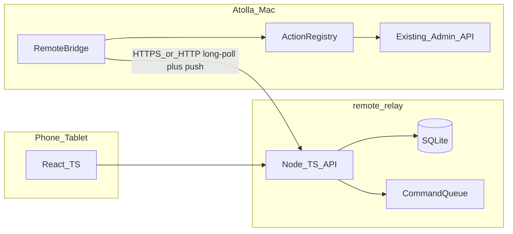

# Atolla 远程中继（remote-relay）设计

日期：2026-10-13  
状态：已确认（Hybrid 方案 3）  
范围：V1 只读 + 基础设施；写操作（Ask 等）仅协议预留

## 1. 目标与边界

### 目标

在公网/局域网服务器上部署轻量中继，让用户用手机或平板查看多台 Mac 上 Atolla 数字人信息、任务状态与聊天历史；后续可扩展「向数字人下达指令」。Mac 不能被服务器主动连入，因此由本机 **出站** 拉指令、推状态。

### V1 范围

- 单站门禁登录（一个网站访问密码，不多用户）
- 实例列表（多台 Mac，Nacos 式注册）
- 查看某实例下的数字人列表
- 查看数字人任务/运行状态
- 查看聊天历史（只读）
- Atolla 管理台配置中继 URL、生成本机实例密码、注册、一键部署脚本

### V1 明确不做

- 多用户账号 / RBAC 细粒度
- 强制 HTTPS / 自动证书
- 手机端 Ask、插话、审批、招聘等写操作
- Docker/K8s 必选、内网穿透、服务器主动连 Mac
- 消息强一致实时流（采用 Hybrid 缓存即可）

## 2. 已锁定决策

| 项 | 选择 |
|---|---|
| 拓扑 | 一中继多 Mac（实例） |
| 同步模型 | Hybrid：热数据定时推镜像；聊天按需 `sync.messages` |
| 通道 | Mac → 云长轮询拉指令 |
| 网站鉴权 | 单站门禁密码 |
| 实例鉴权 | Mac 自生成 6 位（数字+英文）密码，注册到服务器；7 天有效；服务器可吊销 |
| HTTPS | **不强制**（允许 `http://IP:port`） |
| 代码位置 | Atolla 仓内 `remote-relay/` |
| 隐喻 | Nacos 式 Instance 注册 + mailbox 指令队列 |
| 技术栈 | React + Node.js + TypeScript + SQLite |

## 3. 架构



| 模块 | 位置 | 职责 |
|---|---|---|
| `remote-relay/` | 仓内子目录 | Node+TS+SQLite API、React 手机端、deploy 脚本 |
| RemoteBridge | 现有 Go `server/` | 注册/心跳/长轮询/推镜像/执行已注册 action |
| 管理台菜单 | 现有 `web/` | 中继 Base URL、生成/展示/轮换 6 位码、Bridge 开关、一键部署 |

**数据主权**：真相在 Mac 本地 Atolla；云端仅按 `instance_id` 分片的 **缓存镜像 + 指令信箱**。实例离线时手机可读最近镜像并标「离线」。

## 4. Nacos 式实例模型

- 每台 Mac = 一个 **Instance**
- **register**：上报 `instance_id`、显示名、Mac 生成的 6 位密码、`registry_version`、支持的 `action_types[]`
- **heartbeat**：维持 `healthy`；超时（建议 3 次心跳周期未到）→ `unhealthy` / 展示为离线
- **mailbox**：服务器对实例的操作 = 往 `commands` 表投递；实例长轮询拉取后本地执行，再回传 result
- 服务器 **永不** 主动 TCP 连回 Mac

## 5. 行为注册表与协议

### 原则

云端只能入队已声明的 `action_type`；Mac 端必须有同名 handler 才执行。未注册或版本不匹配 → 回写 `rejected`，禁止盲跑。

### V1 action 清单

| action_type | 方向 | V1 | 说明 |
|---|---|---|---|
| `ping` | 云→Mac | 实现 | 探活 |
| `sync.agents` | 云→Mac | 实现 | 立刻推送数字人列表摘要 |
| `sync.tasks` | 云→Mac | 实现 | 推送任务/运行状态 |
| `sync.messages` | 云→Mac | 实现 | 推送某 agent 聊天历史（分页参数） |
| `agent.ask` | 云→Mac | 仅占位 | 无 handler |
| `agent.stop` | 云→Mac | 仅占位 | 无 handler |

### Mac → 云 ingest（实例密码鉴权）

- `POST /api/device/register` — 首次或轮换密码注册
- `POST /api/device/heartbeat`
- `POST /api/device/snapshot/agents`
- `POST /api/device/snapshot/tasks`
- `POST /api/device/snapshot/messages` — 建议支持 `after_id` / 增量
- `GET /api/device/commands/long-poll?wait_ms=25000`
- `POST /api/device/commands/:id/result`

### 长轮询与命令状态机

1. Mac 挂长轮询（默认 wait ≈ 25s）
2. 有待执行命令立即返回（单次建议 ≤10 条）
3. 超时返回空 → Mac 立刻再挂
4. 状态：`pending → leased → done | error | rejected | expired`
5. `leased` 租约建议 60s；超时未回结果 → `expired`（V1 不做自动重试入队，由手机侧提示再 sync）

### 版本协商

Heartbeat / register 携带 `registry_version`（整数，V1=`1`）与 `actions[]`。云端入队前校验；不支持则拒绝入队并提示本机桥接版本过旧。

### 手机触发同步

- 进入实例页：镜像过旧（如 >30s）或刚从离线恢复 → 入队 `sync.agents` + `sync.tasks`
- 打开某同事聊天 → 入队 `sync.messages`；UI 先显示缓存，到齐后刷新

## 6. 安全

### 两套密码（分开）

| 密码 | 生成方 | 用途 | 生命周期 |
|---|---|---|---|
| 网站门禁密码 | 部署时配置 | 浏览器登录读镜像、入队 sync、吊销实例 | 长期；服务器可改密 |
| 实例操作密码 | **Mac 本地生成**（6 位：数字+英文字母） | register / heartbeat / long-poll / snapshot | **7 天**；服务器可删除吊销；Mac 可重新生成并重新注册 |

- 两类密码均 **只存哈希**（argon2id 或 bcrypt cost≥12），不明文落库、不进日志
- 6 位码 **禁止由服务器生成**；服务器只接收并校验
- 吊销：删除/作废该实例当前密码哈希 → 旧码立即失效

### HTTPS

- **不强制**。默认可用 `http://IP:端口`
- 公网裸 HTTP 下 6 位码有窃听风险；用 7 天过期 + 可吊销 + 限速补偿；有证书时可自愿上 TLS，非运行前提

### 防爆破

- 网站登录：按 IP 限速；连续失败临时锁定（如 15 分钟）；统一错误文案
- 实例 register / 鉴权失败：同样按 IP + instance 限速，降低扫 6 位空间效率
- 会话：门禁通过后发短期 JWT（或 signed cookie）；改门禁密码后旧票失效（`token_version`）

## 7. 数据模型（SQLite）

| 表 | 作用 |
|---|---|
| `site_auth` | 门禁密码哈希、`token_version`、锁定计数 |
| `instances` | `instance_id`、显示名、密码哈希、`password_expires_at`、`last_heartbeat_at`、状态、`registry_version`、`actions_json` |
| `commands` | 指令队列（action、payload、状态、租约、结果） |
| `agents_mirror` | 实例下数字人摘要 |
| `tasks_mirror` | 任务/运行状态镜像 |
| `messages_mirror` | 聊天历史镜像（`instance_id` + 本地 `message_id` 唯一） |
| `audit_logs` | 登录失败、注册/吊销、入队（不含聊天正文） |

### 新鲜度建议

- heartbeat：5–10s
- agents/tasks 快照：15–30s，或收到 `sync.*` 立即推
- messages：打开会话时 sync；每 agent 缓存最近约 200 条，更早再按需

## 8. 手机端 V1 页面

1. 门禁登录
2. 实例列表（在线/离线、上次心跳、密码将过期提示；可吊销）
3. 某实例 → 数字人列表（名称、引擎、状态）
4. 数字人详情：当前任务/运行状态
5. 聊天历史只读（下拉加载；触发 `sync.messages`）

## 9. Atolla 管理台集成

菜单「远程中继」（或同等命名）：

- 中继 Base URL
- 生成本机 6 位实例密码（展示一次，本地保存哈希/明文于本机配置目录）
- 一键注册到中继 / 重新注册（轮换密码）
- Bridge 开关与最近心跳状态
- 一键部署：SSH IP/端口/用户、远程目录、监听端口、网站门禁初始密码 → 调用本机 deploy 脚本

## 10. 仓内目录与部署

```text
colleague-avatar/
  remote-relay/
    package.json
    server/          # Node + TS + better-sqlite3（或等价）
    web/             # React + TS 手机端
    deploy/          # rsync + systemd 模板 + 参数化脚本
  server/            # 现有 Go + RemoteBridge
  web/               # 现有管理台菜单
```

### 一键部署 V1

1. 本机脚本参数化：`--host --user --port --remote-dir --site-password`
2. rsync/scp 上传源码或构建产物
3. 远端 `npm ci && npm run build`（或上传已构建产物）
4. 写入 env / 首次写入门禁哈希
5. systemd `Restart=always`，监听指定端口
6. `GET /api/health` 健康检查
7. 成功后回写 Atolla 本地中继 Base URL

不做：自动申请证书、强制 Docker。可另附可选 Dockerfile，非默认路径。

## 11. 错误与离线体验

- 实例离线：列表标红/灰；仍可读镜像；入队 sync 可成功写入队列，但需等实例上线后才执行
- 命令 `expired` / `rejected`：手机 toast 或状态条提示
- Bridge 关闭：停止长轮询与推送；管理台显示断开

## 12. 后续（非 V1）

- `agent.ask` / `agent.stop` 等写操作 handler
- 可选 TLS、多用户、按 agent ACL
- 出站 WebSocket 替代长轮询（若需要更低延迟）

## 13. 验收标准（V1）

1. 服务器上仅运行 `remote-relay`，用门禁密码可登录手机页
2. 两台 Mac（或模拟两个 instance_id）可分别注册；列表可见；可吊销其一密码使其立即无法心跳
3. 健康实例推送后，手机能看到数字人与任务状态
4. 打开聊天触发 `sync.messages` 后，历史可见（只读）
5. 服务器不发起对 Mac 的入站连接；抓包仅见 Mac 出站请求
6. 未配置证书时 HTTP 可完整跑通
