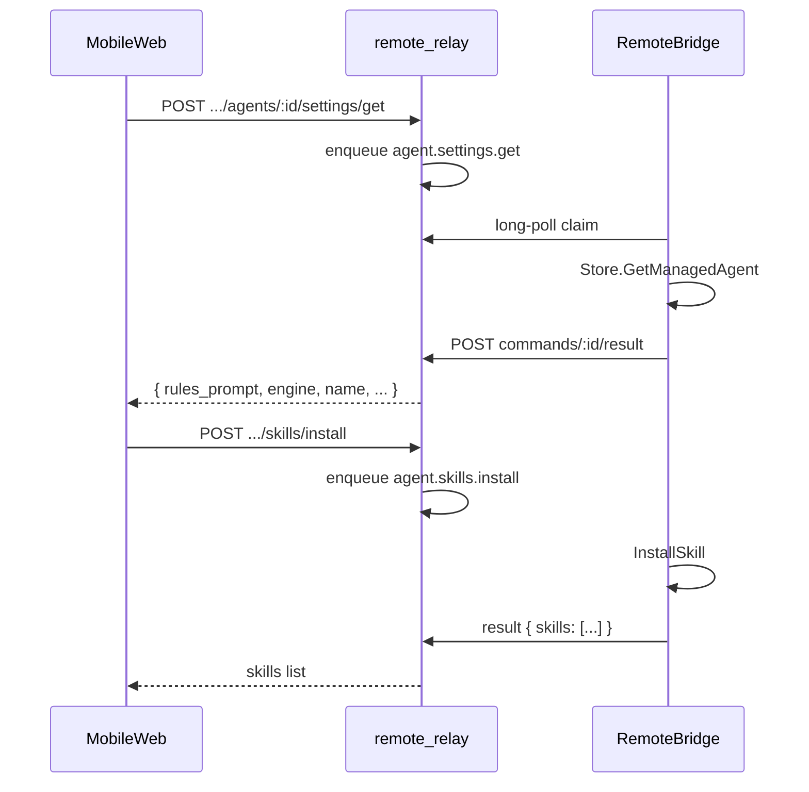

# 移动端数字人设置（提示词 / 技能 / 继承记忆）

日期：2026-10-15  
状态：已确认（用户批准开工）  
范围：remote-relay（中继 API + 手机站）+ Atolla Mac `remotebridge`  
方案：**A — 扩展中继 Command（已确认）**

## 1. 背景与目标

### 痛点

移动端数字人菜单仅支持点击进入对话，无法查看/修改系统提示词、安装技能、查看已继承记忆；PC 端「员工设置」已具备这些能力。

### 目标

1. 在**数字人菜单**与**对话页**增加设置入口。
2. 复刻 PC 设置中与本期相关的能力（见 §2）。
3. 经公网中继安全落到本机 Mac，复用现有 store / 技能 / 记忆逻辑，不另造数据源。

### 非目标（本期明确不做）

- 换引擎（`engine` 创建后不可改，与 PC 一致）
- 改名、上下文窗口、权限开关、工作区、定时、头像
- 记忆书架认领 / 编辑 / 解聘留念
- 技能：自定义发布、数据库源 / 服务器源配置弹窗（安装后如 PC 提示「需在 PC 配置」即可）
- 实时推送设置变更到其它端（保存后刷新本页即可；可选触发 `sync.agents`）

## 2. 已确认决策

| 项 | 选择 |
|----|------|
| 架构 | 扩展 Command（方案 A） |
| 换引擎 | 不做 |
| 系统提示词 | **可编辑并保存** |
| 技能 | **已安装 + 商店安装/卸载**；源配置后置 |
| 继承记忆 | **只读**已挂载列表 |
| 入口 | 列表每行齿轮 + 对话页顶栏齿轮，共用同一设置 Sheet |
| UI 结构 | 三 Tab：基本 / 技能 / 继承记忆（对齐 PC） |
| 读路径 | **不**把完整 `rules_prompt` / 技能列表塞进 agents 镜像（避免镜像膨胀）；按需 RPC |
| 写路径 | Command → Mac 执行 → `result_json` 回传 → 中继 HTTP 同步等待后返回手机 |

## 3. 架构

Ask/stop 仍为 fire-and-forget；**设置类接口改为 enqueue + wait result**（超时约 25–45s），否则手机拿不到提示词/技能列表。

## 4. Mac `remotebridge` Actions

在 `RegisteredActions` / `Handlers` 与 relay `KNOWN_ACTIONS` / `V1_EXECUTABLE` 同步新增：

| Action | Payload | Result（摘要） |
|--------|---------|----------------|
| `agent.settings.get` | `{ agent_id }` | `{ agent_id, name, engine, rules_prompt, skill_count }`（引擎只读展示） |
| `agent.settings.update` | `{ agent_id, rules_prompt }` | 更新后同上字段 |
| `agent.skills.list` | `{ agent_id }` | `{ skills: [...] }`（与 PC `GET .../skills` 同形） |
| `agent.skills.store` | `{ q?, category? }` | `{ skills: [...] }` |
| `agent.skills.install` | `{ agent_id, skill_id, capabilities? }` | `{ skills: [...] }` |
| `agent.skills.uninstall` | `{ agent_id, skill_id }` | `{ skills: [...] }` |
| `agent.legacy_mounts.list` | `{ agent_id }` | `{ items: [...], max: 5 }` |

### 实现约定

- Handler 直接调 `ec.Store` / 现有 service（与 admin handler 同逻辑），**不**走本机 HTTP 自调用。
- `agent.settings.update`：**只改** `rules_prompt`。实现时读取当前 agent，用现有策略字段填满 `UpdateManagedAgent` 所需指针，避免误清空 `allow_*` / workspace（对齐 PC `saveRules` 的「完整策略一并提交」语义，但手机只提交提示词，其余字段用库内现值）。
- `browser-use` 安装长时间阻塞：install 可返回进度文案或超时错误；超时则手机提示「请稍后在已安装列表刷新」；不阻塞其他 Tab。
- 单测：每个 action 的 payload 校验 + happy path（可仿 `bridge_test` / registry 计数更新）。

## 5. remote-relay API

### 5.1 基础设施：`enqueueAndWait`

新增 `enqueueAndWait(db, instanceId, action, payload, timeoutMs)`：

1. `enqueueCommand`
2. 轮询/等待该 `command.id` 进入终态（`done` / `error` / `rejected` / `expired`）
3. 解析 `result_json`；`done` → 200 + body；否则映射 502/504 + error

结果完成时需唤醒 waiters（`submitCommandResult` 侧 notify）。

### 5.2 Site 路由（需 site JWT + instance unlock）

前缀：`/api/instances/:id/agents/:agentId/...`

| 方法 | 路径 | Action |
|------|------|--------|
| `GET` | `/settings` | `agent.settings.get` |
| `PATCH` | `/settings` | `agent.settings.update`（body: `{ rules_prompt }`） |
| `GET` | `/skills` | `agent.skills.list` |
| `GET` | `/skills/store?q=&category=` | `agent.skills.store` |
| `POST` | `/skills/install` | `agent.skills.install` |
| `DELETE` | `/skills/:skillId` | `agent.skills.uninstall` |
| `GET` | `/legacy-mounts` | `agent.legacy_mounts.list` |

全部走 `enqueueAndWait`；Mac 未在线 / 超时 → 明确错误文案。

### 5.3 版本

- `REGISTRY_VERSION`：若协议有破坏性协商需求可 +1；否则保持现有协商，靠 Mac 心跳 `actions` 列表自然开通（旧 Mac 无新 action → enqueue 400「Action not allowed」）。
- `remote-relay` CHANGELOG 升一版（建议 **v0.0.10**）。

## 6. 移动端 UI（`remote-relay/web`）

### 6.1 入口

- **Agents 列表**：每张卡片右侧独立「设置」按钮（`stopPropagation`，不进对话）。
- **ChatHistory**：顶栏右侧增加设置齿轮（与现有审批/主题区协调，避免挤爆；可收入溢出菜单若空间不足，但默认可见）。

### 6.2 `AgentSettingsSheet` 组件

- 全屏或底部 Sheet（沿用现有 `Modal` 风格，移动端优先全屏）。
- Tabs：`基本` | `技能` | `继承记忆`。
- **基本**：只读展示 `name` + `engine`；`textarea` 编辑 `rules_prompt`；保存 → `PATCH settings`；成功 toast/文案。
- **技能**：子 Tab「已安装 / 商店」；列表、详情、安装、卸载；搜索/分类过滤对齐 PC 简化版；**不做** DatabaseSources / ServerSources / 自定义发布。
- **继承记忆**：头像 + 姓名 + 岗位列表；空态文案「尚未继承记忆。可在 PC「数字员工记忆」书架认领。」；刷新按钮。

### 6.3 交互细节

- 打开时按需加载当前 Tab 数据；切 Tab 懒加载。
- busy 态禁用重复提交；网络错误可重试。
- 保存提示词成功后不强制关 Sheet（与 PC 关弹窗不同，手机保留编辑上下文更友好）；可选。

## 7. 测试计划

| 层 | 用例 |
|----|------|
| Mac | registry 含新 actions；settings get/update；skills list/install/uninstall；legacy mounts |
| Relay | enqueueAndWait 成功/超时；各 site 路由鉴权（401/403）；action 未注册 400 |
| Web | 设置入口不误进对话；三 Tab 渲染；保存/安装/卸载 mock API |
| 手工 | 真机：改提示词后 PC 可见；装技能后 PC 技能数变；记忆只读 |

## 8. 风险与缓解

| 风险 | 缓解 |
|------|------|
| Mac 离线导致设置打不开 | 明确错误；列表仍可进对话（对话不依赖设置 RPC） |
| `UpdateManagedAgent` 误清空策略 | update 只传 `rules_prompt` + 用现值填齐策略指针 |
| browser 技能安装过久 | 超时提示 + 手动刷新已安装 |
| 旧 Mac 未升级 bridge | enqueue 拒绝；手机提示升级 Atolla |

## 9. 验收标准

1. 列表与对话页均可打开同一套设置 UI。  
2. 可查看并保存系统提示词，PC 刷新后一致。  
3. 可浏览商店、安装/卸载技能（无源配置弹窗）。  
4. 可只读查看已挂载继承记忆。  
5. 不出现换引擎控件。  
6. CHANGELOG 记录本版变更。
